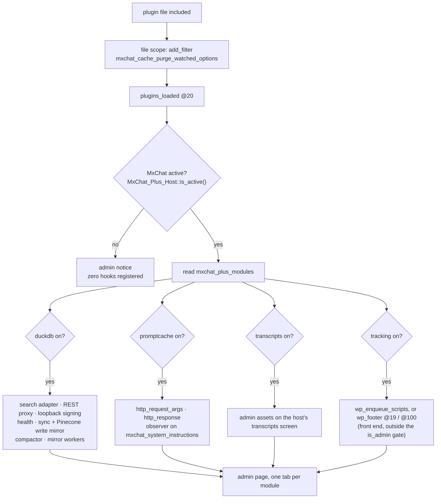
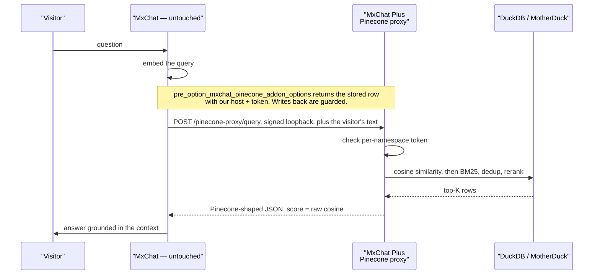
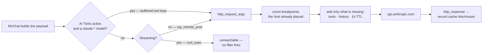

# Architecture

MxChat Plus extends [MxChat](https://mxchat.ai/) (`mxchat-basic`) with four
independent features. MxChat is **third-party software with its own update
stream**, and that single fact shapes every design decision here.

> **The rule this whole plugin is built around:** nothing in this codebase
> modifies MxChat. Not one line. Every feature attaches through WordPress hooks,
> WordPress options, or a REST endpoint the host calls of its own accord.

A patch applied to `mxchat-basic` would be silently overwritten by its next
update, taking the feature with it and leaving no trace of why things broke. So
the interesting part of this architecture is not *what* the modules do — it is
*where they attach*, and which attachment points actually exist.

---

## The four modules

Each is switchable on its own (**MxChat Plus → Modules**). They share no state
and can be reasoned about separately. Two of them listen on the same WordPress
HTTP filters (`http_request_args`, `http_response`), but each acts only on URLs
it owns: `promptcache` on the provider APIs it injects into or measures, `duckdb`
on its own proxy host and — for the write mirror — on the one real Pinecone index
it copied. A site that only wants prompt caching never loads the 26 autoloaded
DuckDB classes.

| Module | What it replaces or adds | Attaches through |
|---|---|---|
| `duckdb` | DuckDB / MotherDuck as the vector store, instead of Pinecone | REST endpoint speaking the Pinecone wire protocol; `pre_option_` / `pre_update_option_` on the host's Pinecone settings row |
| `promptcache` | Anthropic prompt caching + cross-provider savings metrics | `http_request_args`, `http_response`, and a read-only observer on the host filter `mxchat_system_instructions` |
| `transcripts` | CSV export of the selected conversations, of a date range, or of the conversation open in the details drawer | `admin_enqueue_scripts` + an AJAX action of our own |
| `tracking` | Matomo / GA4 events for link and suggestion clicks (and, opt-in, chat opened), plus a report over the host's own click table | `wp_enqueue_scripts` (or `wp_footer` under MxChat's smart asset loading) + a capture-phase DOM listener |

`tracking` is the only module that **defaults to off**, and the only one that
puts code on a public page. Both follow from the same fact: it is the one feature
that sends data to a third party, which is a decision for the site owner rather
than a default.

---

## Boot sequence



Priority **20** is not arbitrary: MxChat builds its globals on `plugins_loaded`
at the default priority, so the host gate is only meaningful after it has run.

One hook is registered **before** that gate, at file scope in `mxchat-plus.php`:
`mxchat_cache_purge_watched_options`. MxChat reads that filter exactly once, in
the constructor of `MxChat_Cache_Purge`, which `mxchat_init()` builds on
`plugins_loaded` at priority 10 (MxChat 3.2.25) — registered from `boot()` at 20
it would never be read. It is harmless when MxChat is absent: nothing applies it.

**Class loading.** A static classmap
(`includes/core/class-mxchat-plus-autoloader.php`) maps all 38 classes to their
files. This is deliberate, and it replaced a live fatal: the merged plugin used
a hand-ordered `require_once` list when Composer was absent, and that list
required the MotherDuck connection *before* its parent class — so any install
made by `git clone` (the documented method) died at boot. A classmap makes load
order irrelevant by construction.

`composer.json` declares **no runtime `autoload` section**. Composer is
development tooling here (PHPUnit, PHPStan); `vendor/` is never shipped.

---

## Integration surface: what actually exists in MxChat 3.2.25

This is the expensive knowledge — the part no amount of reading *our* code
gives back. It was established by reading the MxChat 3.2.25 source and diffing it
against the 3.2.21 copy kept in `mxchat-basic/` for grepping. Nothing in this
repository has been exercised inside a running WordPress, so read it as "what the
host code says", not as observed behaviour.

Host code is cited by **function name and version**, never by bare line number:
line numbers move with every MxChat release, function names rarely do.

### Hook inventory

Counted with a **multi-line-aware** scan of every `apply_filters()`,
`do_action()` and `*_ref_array()` call whose first argument is a string literal,
across every PHP file of the host. (The "53 hooks" this document used to quote
for 3.2.21 came from a single-line grep, which misses the calls whose hook name
sits on the next line — `mxchat_satisfaction_rating_enabled`,
`mxchat_page_context_content`, `mxchat_embedding_chunk_metadata`. The real 3.2.21
figure is 56.)

| | MxChat 3.2.21 | MxChat 3.2.25 |
|---|---|---|
| Hook names | 56 (50 filters, 6 actions) | **75** (69 filters, 6 actions) |
| Call sites | 93 | 118 |
| `wp_ajax_*` names (22 `nopriv` in both) | 148 | 156 |
| REST routes registered | 11 | 13 |
| `window.*` functions exported to add-ons | 33 | 33 (unchanged) |

Of the 75 names, one is third-party (`litespeed_purge_all`, fired by the host for
LiteSpeed Cache) and one is a dynamic family (`mxchat_seo_optimize_{field}`),
which leaves 73 literal MxChat hooks plus that family. No hook was removed and no
argument count changed between 3.2.21 and 3.2.25. The 19 added names are all
filters:

| Area | Filters added since 3.2.21 |
|---|---|
| Chat and context | `mxchat_ai_conversation_history`, `mxchat_current_datetime_line`, `mxchat_transcript_user_message`, `mxchat_handoff_card_sections`, `mxchat_client_ip`, `mxchat_rate_limit_max_visitor_counters` |
| AI Tools (function calling) | `mxchat_fc_keep_first_hop_text`, `mxchat_function_calling_budget_notice` |
| Front-end toolbar | `mxchat_chat_toolbar_items`, `mxchat_chat_toolbar_items_allowed_html` |
| Pinecone document index | `mxchat_pinecone_is_document_host`, `mxchat_pinecone_expected_dimension`, `mxchat_pinecone_migrate_step_seconds`, `mxchat_pinecone_bots_on_host` |
| Knowledge base | `mxchat_kb_attachment_mime_types`, `mxchat_reference_inline_cap`, `mxchat_reference_shortcodes` |
| Gemini | `mxchat_gemini_safety_settings`, `mxchat_gemini_thinking_level` |

Beyond PHP hooks, 3.2.25 adds two DOM events dispatched on `document` by
`js/chat-script.js` — `mxchat:toolbar-ready` (once, detail `{ enabled }`) and
`mxchat:opened` (once per bot per page, detail `{ botId, embedded }`, mirrored in
`window.MxChatInstances.opened`) — and the constant `MXCHAT_TOOLBAR_ITEMS_API`.
The eight new AJAX actions are `mxchat_kb_reimport`, `mxchat_license_check_now`,
`mxchat_license_notice_dismiss` and the five Pinecone document-index actions
`mxchat_pinecone_docs_{check_index, create_index, suggest_name, migrate,
delete_old_index}`. The two new REST routes are `DELETE /mxchat/v1/knowledge` and
`GET /mxchat/v1/leads`.

**Still absent in 3.2.25**, and therefore never relied on: `mxchat_pre_vector_query`,
`mxchat_pinecone_matches_override`, `mxchat_before_query`, and any filter on the
Claude streaming payload.

### The seams MxChat Plus actually uses

| Seam | Kind | Module | Why |
|---|---|---|---|
| `pre_option_mxchat_pinecone_addon_options` | WP core, on a host option | duckdb | default-bot takeover (opt-in) |
| `pre_update_option_mxchat_pinecone_addon_options` | WP core, on a host option | duckdb | keeps the real credentials when the Pinecone card is saved |
| `mxchat_get_bot_pinecone_config` | host filter | duckdb | Multi-Bot routing (opt-in) |
| `mxchat_retrieval_query` | host filter, observed (3.2.20+) | duckdb | the visitor's text for hybrid BM25 |
| `mxchat_pinecone_query_body` | host filter, observed (3.2.20+) | duckdb | which bot a `/query` is for |
| `mxchat_before_process_post`, `mxchat_get_bot_options` | host filters, applied | duckdb | "Reprocess all posts" behaves like MxChat's import |
| `wp_ajax_mxchat_kb_reimport`, `wp_ajax_mxchat_update_role_restriction` | host AJAX, observed at priority 1 | duckdb | schedule a re-sync of rows rewritten in place |
| `wp_ajax_mxchat_pinecone_docs_*` | host AJAX, answered at priority 1 | duckdb | refused while the takeover is on |
| `wp_ajax_mxchat_delete_pinecone_prompt`, `…_delete_chunks_by_url`, `…_bulk_delete_knowledge` | host AJAX, observed at priority 1 | duckdb | cascade MxChat's deletes into DuckDB |
| `http_request_args`, `http_response`, `pre_http_request` | WP core | duckdb, promptcache | loopback signing and query text; Pinecone write mirror; token guard; cache injection and metrics |
| `mxchat_system_instructions` | host filter, observed | promptcache | detects a `{current_datetime}` system prompt |
| `mxchat_fc_keep_first_hop_text` | host filter, applied read-only (3.2.22+) | core | the Modules screen's streaming row |
| `mxchat_cache_purge_watched_options` | host filter | tracking | page-cache purge when our public settings change |
| `mxchat:opened`, `window.getBotIdFromElement`, `window.getChatSession` | host JS | tracking | chat-opened event, bot and session ids |

Host helpers newer than the minimum supported host are always called behind
`class_exists` / `is_callable`, with a fallback: `MxChat_Utils::embedding_preflight()`,
`get_selected_embedding_model()`, `standard_embedding_dimension()`,
`forget_attachment_signature()` and `forget_all_attachment_signatures()` (3.2.24+),
`MxChat_Pinecone_Documents::is_document_host()`, `MxChat_Public::should_load_assets()`,
`MxChat_Tool_Registry` and `MxChat_Model_Catalog`. Two private methods of
`MxChat_Knowledge_Manager` (the post-content assembler and the role re-application,
both present since 3.2.21) are reached by reflection, with a fallback when they
disappear.

### Vector retrieval

`mxchat_get_bot_pinecone_config` exists, but **it is consulted only for
non-`default` bots, and only when the Multi-Bot add-on is loaded**
(`class_exists('MxChat_Multi_Bot_Manager')`). For the default bot — almost every
install — MxChat reads the `mxchat_pinecone_addon_options` option directly, in six
places: `MxChat_Utils::is_pinecone_enabled_for_bot()`,
`MxChat_Integrator::get_bot_pinecone_config()`, `MxChat_Public::get_bot_pinecone_config()`,
`MxChat_Pinecone_Manager::mxchat_get_bot_pinecone_options()` and
`::get_bot_pinecone_config()`, and `MxChat_Pinecone_Documents::config()` (MxChat
3.2.25).

**Consequence:** the proxy cannot install itself through that filter for the
default bot. It hooks `pre_option_mxchat_pinecone_addon_options` instead, so the
host reads our host and token where it expected Pinecone's — and calls our REST
endpoint believing it is calling Pinecone. The answer is the **stored row with
five keys replaced**: `mxchat_use_pinecone` `'1'`, the proxy token as API key, the
proxy as host, namespace `default`, and `mxchat_pinecone_index_type` forced to
`vector`. Everything else — MxChat's Top K, the document-index bookkeeping, the
index name — passes through untouched, so MxChat's own Top K applies.

The index type is forced because MxChat 3.2.22+ can talk to a Pinecone **document
index** (`MxChat_Pinecone_Documents`, retrieval in
`MxChat_Integrator::find_relevant_content_pinecone_documents()`), an opt-in second
protocol the proxy does not speak. A missing key already reads as `vector`
(`MxChat_Pinecone_Documents::options_index_type()`); a stored `document` would
send MxChat to paths the proxy answers with a 501.

**What is written, and what guards it.** A `pre_option_` filter writes nothing by
itself, but MxChat writes back what it reads in three places, and each is guarded:

- `MxChat_Admin::sanitize_pinecone_settings()` reads the option to carry the
  namespace and the verified document host (3.2.22+). While
  `sanitize_option_mxchat_pinecone_addon_options` runs, the takeover steps aside and
  the sanitizer sees the real row.
- Saving MxChat's Pinecone card posts back the values the card was rendered with —
  ours. `pre_update_option_mxchat_pinecone_addon_options` restores the real API key,
  host, use flag, namespace and index type, but only when the incoming value carries
  our token or our proxy host; a genuine edit such as Top K goes through.
- The card's document-index actions (`wp_ajax_mxchat_pinecone_docs_*`) would send
  the proxy token to Pinecone and record the proxy host as the index to migrate
  from. While the takeover is on they are answered with a JSON error at priority 1,
  before MxChat's handler; a `pre_http_request` guard also refuses any request to
  `*.pinecone.io` that carries one of our tokens; and a notice on MxChat's Knowledge
  screen says why the card shows the proxy's values.

Turning the module off gives MxChat its stored row back unchanged. One gap remains
and is documented in the code: on a site where the option has never been stored,
the first save of the card is lost (WordPress compares against the filtered value
and updates nothing). The takeover is **opt-in and off by default**
(`takeover_default_bot_pinecone`): silently redirecting a working Pinecone install
is not a decision a plugin should make on its own.

**Multi-Bot bots** are routed through `mxchat_get_bot_pinecone_config` only when
opted in — every bot (`takeover_multibot_bots`) or a list of bot ids
(`takeover_bot_ids`). A routed bot gets a token of its own, a namespace named after
its bot id, and index type `vector`; it no longer sees the knowledge MxChat keeps in
the WordPress database, which all bots share. `default`, `testing`, `''` and any bot
whose own config says `document` pass through untouched. Installs from before the
setting keep routing exactly the non-default bots that already have vectors in
DuckDB.



MxChat never learns it is not talking to Pinecone. No patch, nothing to
re-apply after an update.

**What the proxy speaks.** The subset of the classic vector-index protocol MxChat
3.2.25 sends: `POST /query`; `GET|POST /vectors/fetch` (every host caller uses
`wp_remote_get` with the ids **repeated** — `ids=a&ids=b` — since 3.2.20);
`POST /vectors/upsert`; `POST /vectors/delete`; `GET|POST /vectors/list` with
`paginationToken` and an opaque `pagination.next` returned only while more ids
exist (MxChat's paging loops run until it is absent); `GET|POST
/describe_index_stats`, which the 3.2.22 Knowledge screen uses for its count and
cursor paging. Document-index paths answer a readable 501, and a malformed filter
a 400, as Pinecone would.

Three details of that loopback are load-bearing:

- **The visitor's text never reaches the proxy on its own** — the proxy is a
  separate HTTP request that carries only the embedding. The module captures it on
  the host filter `mxchat_retrieval_query` and adds it to the `/query` body on
  `http_request_args`, only when the target is our proxy, so a real Pinecone index
  never sees it. `mxchat_pinecone_query_body` is observed only to learn the bot: it
  is not told which host the body is for.
- **MxChat's own calls are signed.** On `http_request_args`, requests to the proxy
  host get an HMAC header bound to method, path, minute and token. Signed calls
  are exempt from the external rate limit (`/query` keeps its own, larger bucket),
  so bulk admin flows such as `DELETE /mxchat/v1/knowledge` or kb-reimport do not
  fail with 429.
- **Every score is the raw cosine.** MxChat filters and sorts on `score` (its
  similarity threshold, 0.35 by default, and a video-card floor, 0.55 by default),
  so the distance metric and the hybrid blend only choose and order the top-K;
  neither ever replaces the score.

MxChat reuses the same vector id — `md5(url)`, plus `_chunk_N` — in **every** bot's
namespace, as Pinecone namespaces allow. The DuckDB table is therefore keyed on
`(bot_id, vector_id)` since schema v4; under the old single-column key, one bot's
upsert overwrote another bot's row with the same id. See
[`docs/duckdb/ARCHITECTURE.md`](docs/duckdb/ARCHITECTURE.md).

A second path exists — a `mxchat_pre_vector_query` filter that would skip the
HTTP round-trip entirely. **That filter does not exist upstream** (verified absent
in 3.2.25). The `mxchat_pinecone_query_body` filter added in 3.2.20 cannot stand in
for it: it only rewrites the request body, and the host still makes the call. Our
handler is registered anyway (it costs one `add_filter` and stays inert), so it
would start working the day MxChat adds it. See
[`docs/duckdb/ARCHITECTURE.md`](docs/duckdb/ARCHITECTURE.md).

### Prompt caching

Four facts govern this module, and all are invisible from our side of the code.

**1. Streaming bypasses the WordPress HTTP API — except where AI Tools take
over.** MxChat streams through `curl_exec` (8 call sites in
`class-mxchat-integrator.php`, among them
`MxChat_Integrator::mxchat_generate_response_claude_stream()`), which no WordPress
filter can reach. The streamed payload still carries MxChat's own 5-minute system
breakpoint; what it loses is this module's additions. The non-streamed path,
`mxchat_generate_response_claude()`, posts through `mxchat_provider_call_with_retry()`
(`wp_remote_post`, up to three attempts — our filters run once per attempt).
With **AI Tools** active and a `claude-*` model (MxChat ≥ 3.2.22), the
function-calling loop runs before the streaming decision, buffered, through that
same wrapper, and since 3.2.22 a first hop that calls no tool is kept as the answer
(`mxchat_fc_keep_first_hop_text`, default `true`) — so most turns are cacheable
even with streaming on. The Modules screen states which case applies.

**2. MxChat already caches its own system prompt.** Since 3.2.21,
`mxchat_anthropic_system_blocks()` marks the system block with
`cache_control: ephemeral`, which also covers the AI Tools definitions rendered
before it. Anthropic allows **at most four breakpoints per request** and rejects
the request beyond that — so this module counts the host's existing breakpoints
against the budget before adding any of its own, and never duplicates one.

**3. The last message of every chat request is a per-turn context block.**
`mxchat_handle_chat_request()` appends the date line, `User asked: '…'` and the
knowledge-base excerpt as a final `user` message that it **never stores**, so the
next turn does not send it again. A history breakpoint there would pay the write
premium on thousands of tokens for nothing; the rolling pair goes on the visitor's
raw messages instead (the host literal `User asked: '` is how the block is
recognised).

**4. `{current_datetime}` (3.2.22+) makes the system prompt change every minute.**
A read-only observer on `mxchat_system_instructions` records the value MxChat
substituted; when the system prompt is volatile, the module adds no system or
history breakpoint and does not lengthen the host's 5-minute marker.
`{current_date}` stays cacheable.



What the module adds on top of the host: a **tool-definitions** breakpoint that
keeps tools cached when the system prompt varies (the host's own marker already
covers tools and system together), a rolling pair on the **visitor's last two raw
messages**, 5-minute breakpoints inside the AI Tools loop, the **1-hour TTL**,
per-model minimum thresholds, and persisted cross-provider metrics (Anthropic,
OpenAI Chat Completions and Responses, OpenRouter, xAI, DeepSeek, Gemini native and
OpenAI-compatible, and MxChat's custom provider). The details are in
[`docs/promptcache/USAGE.md`](docs/promptcache/USAGE.md).

### Transcripts export

MxChat ships `wp_ajax_mxchat_export_transcripts`, but it dumps the **entire
table** and ignores the checkboxes (`MxChat_Admin::export_chat_transcripts()`,
still unfiltered in 3.2.25). Exporting a selection needed its own path.

Its toolbar offers no action or filter hook, so the buttons are injected
client-side. The host keeps its `selectedSessions` Set inside its own closure
(`js/mxchat_transcripts.js`), and that Set outlives the 50 rows on screen, so the
selection is **mirrored** in the browser: from delegated `change` events on the
row checkboxes (the host stops `click` from propagating, not `change`), from
`#mxch-select-all`, and from a successful `mxchat_delete_chat_history`
response. The conversation open in the details drawer is private too
(`currentSessionId`), so it is learnt from the host's `mxchat_fetch_conversation`
AJAX traffic; a second button next to `#mxch-export-current` exports just that
one. Date ranges are site-local days converted to UTC
(`MxChat_Plus_Transcripts_Export::local_range_to_gmt()`), because the host stores
GMT. All of these are concessions to the no-modification rule — documented here
so they read as deliberate rather than sloppy.

### Click tracking

MxChat **does** log link clicks server-side. In `js/chat-script.js`,
`trackLinkClick()` sends `mxchat_track_url_click` with `navigator.sendBeacon`
(falling back to `$.ajax`); it is called from `attachLinkTracking()` for regular
answers and from a delegated `.chat-box a[href]:not([data-tracked])` handler for
streamed, restored and intro links. `MxChat_Integrator::mxchat_track_url_click()`
inserts into `{prefix}mxchat_url_clicks` (MxChat 3.2.25). So the module is
deliberately *not* a reimplementation of that: its admin half reads that table and
reports on it, because the host only ever shows a `DISTINCT clicked_url` list per
conversation and exposes nothing in its CSV or REST output.

The browser half exists for what the table structurally cannot hold: what the
visitor does *after* following the link. Three host facts shape it, and each is
load-bearing:

- **The listener must be in the capture phase.** The host binds its own handler
  directly on each `<a>` and calls `stopPropagation()` (`attachLinkTracking()`,
  MxChat 3.2.25). A bubble-phase listener on `document` never sees those clicks.
  Capture runs on the way down and always fires.
- **The handler must never call `preventDefault()`.** Since MxChat 3.2.24 the host
  cancels no link click: it lets the browser follow the anchor while it records
  the click with `sendBeacon`. A `preventDefault()` of ours would strand **every**
  link in an answer, absolute ones included — and navigation must never be held and
  resumed from a callback (Safari's pop-up blocker drops it; that is the bug 3.2.24
  removed). `passive: true` is the structural guarantee. Same-tab events survive the
  unload only through the analytics tracker's own beacon transport (Matomo 4+ by
  default).
- **Bot id and session id come from the host's own globals.**
  `window.getBotIdFromElement` and `window.getChatSession` are exported "for
  add-ons" at the end of `chat-script.js`'s ready handler (MxChat 3.2.25).
  Re-deriving them from the DOM is what the standalone predecessor did, and it got
  both wrong: the suggestion buttons live in `#mxchat-popular-questions-{botId}`,
  which `MxChat_Public::render_chatbot_shortcode()` prints **after** `#chat-box-{botId}`
  closes, as a sibling — so a chat-box walk resolves nothing for them; and a
  hand-rolled cookie read misses the in-memory session the host keeps when cookies
  and localStorage are both blocked.

Suggestion clicks and chat-open events are sent from a `setTimeout(0)` — a
macrotask, never a microtask — so that the host's own handler, which may create the
session, runs first. Link clicks are never deferred.

The opt-in **chat-opened** event listens for `mxchat:opened` (3.2.22+) and, for a
script that loads late, reads `window.MxChatInstances.opened`; an embedded chatbot
is never reported, since it is on screen from the start.

The dependency array of the enqueue is empty **on purpose**: under MxChat's
`delay` and `interaction` loading strategies the host never registers its
`mxchat-chat-js` handle, and WordPress silently drops any script whose
dependency is missing. With MxChat's **smart asset loading** on (host option
`mxchat_smart_asset_loading`), the tracker follows the host's own decision:
`MxChat_Public::should_load_assets()` at `wp_enqueue_scripts`, otherwise a deferred
decision at `wp_footer` — enqueue at priority 19 when the host's `mxchat-chat-css`
handle is enqueued (its own safety-net signal), and enqueue plus `wp_print_scripts()`
at 100 for a widget rendered after the footer scripts. With the option off, the
output is byte-identical to before.

---

## Repository layout

```
mxchat-plus.php              bootstrap: constants, autoloader, host gate, modules
uninstall.php                single entry point (WordPress runs only one)
includes/
  core/                      gate, module registry, autoloader, tabbed admin page
  duckdb/                    vector store — see docs/duckdb/ARCHITECTURE.md
  promptcache/               cache_control injection, metrics, CLI, dashboard
  transcripts/               CSV export of the host's selected conversations
  tracking/                  Matomo/GA4 click events + report over mxchat_url_clicks
admin/views/duckdb/          settings view + section partials
admin/views/tracking/        settings view (form + clicked-links report)
assets/js/                   admin scripts, plus tracking.js (the only front-end one)
languages/                   .pot, .po and the compiled .mo (shipped)
tests/unit/{duckdb,promptcache,transcripts,tracking}/   one suite per module
tools/patches/               optional upstream patch — excluded from the release zip
```

---

## Conventions that are load-bearing

Not style preferences — each one silently breaks something when violated.

- **Host symbols are untouchable.** Literals like `mxchat_options`,
  `mxchat_pinecone_*`, `mxchat_system_prompt_content`, `mxchat_chat_transcripts`
  and `wp_ajax_mxchat_bulk_delete_knowledge` belong to MxChat, and so do the
  strings the modules match on — `User asked: '` and
  `Preserved code blocks are marked with [CODE BLOCK PRESERVED].` (prompt caching),
  the `mxchat_pinecone_roles` table, the `mxchat-chat-css` handle. Each is kept in
  a documented constant. Our own symbols all carry a `mxchat_plus_` /
  `MxChat_Plus_` / `MXCHAT_PLUS_` prefix, which is what makes the two sets safely
  separable.
- **`includes/duckdb/class-duckdb-*.php` basenames are matched by
  `phpstan/UnsafeSqlConstructionRule.php`**, the project's only guard against
  SQL built by concatenation. Renaming those files disables it silently.
- **Test shims load before the autoloader** (`tests/bootstrap.php`). Their
  `class_exists()` guards would otherwise pull in the real class and the test
  doubles would never take effect.
- **In a test file, a `class_exists()` guard must pass `false` as its second
  argument.** `composer.json` classmaps `tests/` into `autoload-dev`, so a fresh
  `composer install` resolves a helper double to the very file being parsed. An
  autoloading guard then re-includes that file mid-parse: the nested pass
  declares the test class, the outer pass redeclares it, and PHP dies. A file
  whose declarations are *all* guarded survives this by accident; one that mixes
  guarded and unguarded declarations does not. It is invisible on a stale
  `vendor/` and fatal on a clean clone — `composer dump-autoload` is what makes
  it reproducible locally.
- **The click tracker must listen in the capture phase and never cancel an
  event.** MxChat binds its own handler directly on each `<a>` and calls
  `stopPropagation()`, and since 3.2.24 lets the browser follow every link
  natively. A bubble-phase listener records nothing; a `preventDefault()` of ours
  strands the visitor on every link in an answer.
- **The purge-watch filter stays at file scope.** `mxchat_cache_purge_watched_options`
  is read once, on `plugins_loaded` at priority 10; moved into `boot()` (priority 20)
  it would silently never apply.
- **The prompt-cache model table is order-sensitive.**
  `min_chars_for_model()` tests `mythos-preview` before `mythos`, `haiku-4`
  before `haiku`. Reordering the clauses is a real regression — it already
  happened once, and is now locked by a test.
- **Run PHPStan through `composer stan`**, which passes `--memory-limit=512M`.
  Invoking `vendor/bin/phpstan` bare crashes on PHP's 128M default, and a
  crashed run reports "no errors" just like a clean one.

See [`CONTRIBUTING.md`](CONTRIBUTING.md) for the commands, and
[`docs/`](docs/) for per-module guides.
