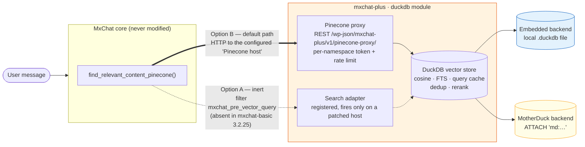
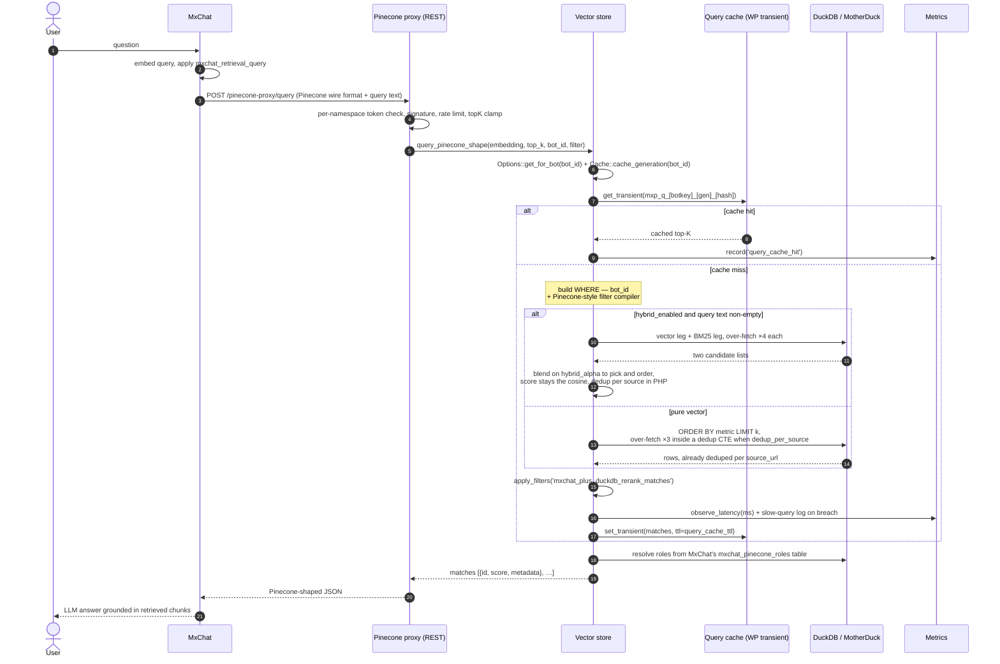

# Architecture — DuckDB vector store

How the **`duckdb` module** plugs into MxChat, how a query flows through it, and where each
class lives.

This document covers the vector-storage subsystem only. For the plugin as a whole — the four
modules (`duckdb`, `promptcache`, `transcripts`, `tracking`), the boot sequence, the
autoloader, the host hook inventory and the repository layout — see
[`../../ARCHITECTURE.md`](../../ARCHITECTURE.md).

Host code is cited by function name and MxChat version rather than by line number. Everything
below was checked against the MxChat 3.2.25 source; nothing here has been exercised inside a
running WordPress.

---

## How it plugs into MxChat

`mxchat-basic` is third-party software with its own update stream, so the module attaches
through hooks, options and a REST endpoint the host calls of its own accord — **nothing in
this codebase modifies MxChat**.

There are two possible attachment points on the retrieval path. Only one of them exists
upstream today, and that is the one the module actually runs on.



### Option B — Pinecone wire-protocol proxy (the default, and the only path that runs on a stock host)

The module tells MxChat that its Pinecone backend is this very site, then serves a REST
namespace at `/wp-json/mxchat-plus/v1/pinecone-proxy/` that emulates the subset of Pinecone's
**classic vector-index** protocol MxChat 3.2.25 sends:

| Endpoint | Used by MxChat for |
|---|---|
| `POST /query` | retrieval at chat time, and the admin search and listing sweeps |
| `GET\|POST /vectors/fetch` | chunk reassembly, View/Edit/Inspect, the processed-content scan, kb-reimport. Every host caller sends a `GET` with the ids **repeated** (`ids=a&ids=b`) since 3.2.20; `ids[N]=` and a JSON `POST` body are also accepted. Answers `{vectors: {<id>: {id, values, metadata}}, namespace, usage}` |
| `POST /vectors/upsert` | every write; title, `parent_url_hash`, `created_at`, `last_updated` and add-on metadata keys round-trip |
| `POST /vectors/delete` | deletes by id. `deleteAll` or a filter-only body (no ids) answers 400 rather than a silent 200 |
| `GET\|POST /vectors/list` | prefix listing with keyset paging: `paginationToken` (query or body) in, an opaque `pagination.next` out **only while more ids exist** — MxChat's `do … while` paging loops stop when it is absent |
| `GET\|POST /describe_index_stats` | the 3.2.22 Knowledge screen's count and cursor paging: `{namespaces: {<bot>: {vectorCount}}, dimension, totalVectorCount, …}`. A bot's token sees only its own namespace; the legacy global token sees all |
| `/namespaces/…`, `/documents/…` (any method) | **501** with a readable message: the document-index protocol (MxChat 3.2.22+) is not emulated |

The proxy authenticates the per-namespace token, rate-limits the caller and translates each
call into DuckDB SQL. A malformed filter or an unsupported operator answers 400, as Pinecone
does. MxChat never learns it is not talking to Pinecone, and there is nothing to re-apply
after a host update.

**How MxChat is pointed at it.** MxChat resolves the Pinecone config two different ways, so
there are two seams (`MxChat_Plus_DuckDB_Search_Adapter::register_hooks()`), both opt-in:

- **The default bot** — almost every install. MxChat reads `mxchat_pinecone_addon_options`
  straight from `wp_options` for it: `MxChat_Utils::is_pinecone_enabled_for_bot()`,
  `MxChat_Integrator::get_bot_pinecone_config()`, `MxChat_Public::get_bot_pinecone_config()`,
  `MxChat_Pinecone_Manager::mxchat_get_bot_pinecone_options()` / `::get_bot_pinecone_config()`
  and `MxChat_Pinecone_Documents::config()` all short-circuit on
  `$bot_id === 'default' || !class_exists('MxChat_Multi_Bot_Manager')` (MxChat 3.2.25). The
  WP-core filter `pre_option_mxchat_pinecone_addon_options` answers that read with the
  **stored row, five keys replaced**: `mxchat_use_pinecone` `'1'`, the default namespace's
  proxy token, the proxy host, namespace `default`, and `mxchat_pinecone_index_type` forced to
  `vector` — the proxy speaks only the classic protocol, and a stored `document` would send
  MxChat down `find_relevant_content_pinecone_documents()`. MxChat's Top K and the
  document-index bookkeeping pass through, and a missing Top K is filled from this plugin's
  `top_k`. Gated by `takeover_default_bot_pinecone` (**off by default**), so sites pointing at
  a real Pinecone index are not hijacked by installing the plugin.
- **Multi-Bot bots** — `mxchat_get_bot_pinecone_config`, which MxChat asks for every other
  bot when the Multi-Bot add-on is loaded. Answered only for the bots opted in: all of them
  (`takeover_multibot_bots`) or the listed ids (`takeover_bot_ids`). A routed bot gets a token
  of its own, a namespace named after its bot id and index type `vector`; it reads only its own
  namespace, so it no longer sees the knowledge MxChat keeps in the WordPress database, which
  all bots share. `default`, `testing`, `''` and any bot whose own config says `document` pass
  through untouched. An install from before the setting has no `takeover_bot_ids` key and keeps
  routing exactly the non-default bots that already have vectors in DuckDB
  (`Options::maybe_migrate_bot_routing()`, retried every 5 minutes while DuckDB cannot be read).

**The write side of the default-bot takeover.** Reading through `pre_option_` writes nothing,
but MxChat writes back what it reads, so three guards keep the stored row real:

- while `sanitize_option_mxchat_pinecone_addon_options` runs, the takeover steps aside, so
  `MxChat_Admin::sanitize_pinecone_settings()` (which carries the namespace and verified
  document host from its own read, 3.2.22+) sees the real row;
- `pre_update_option_mxchat_pinecone_addon_options` restores the real API key, host, use
  flag, namespace and index type when — and only when — the value being saved carries our
  token or proxy host, so saving MxChat's Pinecone card keeps the real credentials and genuine
  edits such as Top K still go through;
- the card's document-index actions (`wp_ajax_mxchat_pinecone_docs_create_index`,
  `_check_index`, `_suggest_name`, `_migrate`, `_delete_old_index`, from
  `MxChat_Pinecone_Documents::boot()`) are answered with a JSON error at priority 1 while the
  takeover is on; a `pre_http_request` guard refuses any request to `*.pinecone.io` that carries
  one of our proxy tokens; and a notice on MxChat's Knowledge screen explains the card.

Known gap: on a site where `mxchat_pinecone_addon_options` was never stored, the first save of
the card is lost (WordPress compares against the filtered old value and updates nothing).

**The loopback.** MxChat calls the proxy over HTTPS on its own host, a separate request from the
visitor's chat request. Three things ride along on `http_request_args`, and only for URLs under
the proxy host:

- **A signature.** `X-MxChat-Plus-Internal`, an HMAC-SHA256 keyed from `wp_salt('auth')` and
  bound to method, path, minute and token (the current and previous minute are accepted). It is
  checked only after the token. Signed calls are exempt from the external 120/min limit — except
  `/query`, which keeps its own, larger bucket — so bulk admin flows (REST
  `DELETE /mxchat/v1/knowledge`, kb-reimport) neither fail with 429 nor starve visitors' chats.
  If a CDN or reverse proxy strips the header, calls simply fall back to the external limit.
- **The visitor's text.** It never reaches the proxy on its own. The module observes the host
  filter `mxchat_retrieval_query` (at `PHP_INT_MIN` for the original message, `PHP_INT_MAX` for
  the final value, returned unchanged) and adds the text to the `/query` body as
  `mxchat_plus_query_text` (2000 characters at most). A real Pinecone index never sees it. In
  the proxy request it becomes the default value of `mxchat_plus_duckdb_query_text`, so hybrid
  BM25 works with no hand-wired filter.
- **The bot.** `mxchat_pinecone_query_body` is observed only to learn which bot a `/query` is
  for; it is not told which host the body goes to, so it cannot carry the text itself.

Both host filters exist since MxChat 3.2.20 and are unchanged in 3.2.25.

**Roles.** MxChat decides access from `metadata.role_restriction` when it is non-empty, and
otherwise from its own `{prefix}mxchat_pinecone_roles` table. The proxy therefore never reports
`public`: after the query cache it reads that table (read-only, 200 ids per statement) for the
exact id, then for the base `md5(url)` of a `_chunk_N` match — deliberately stricter than real
Pinecone, which leaks chunks of restricted pages — then falls back to a non-public stored role,
and otherwise omits the key. Role changes apply on the next query.

**Scores.** `matches[].score` is always the raw cosine similarity, whatever the distance metric
and with hybrid on. MxChat filters on it (its similarity threshold, 0.35 by default, and the
video-card floor, 0.55 by default) and re-sorts by it, so the metric and the hybrid blend only
choose and order the top-K.

Operationally the proxy has three prerequisites — working HTTPS loopback, pretty permalinks,
and a reachable `/wp-json/` — documented in the [README](../../README.md). Two of them are
hard for a reason: MxChat always prefixes `https://`, so an HTTP-only site cannot loop back;
and on plain permalinks the proxy host is `example.com/?rest_route=/mxchat-plus/v1/pinecone-proxy`,
to which MxChat appends a second `?…` for its `GET` list and fetch calls — those very likely
fail there (not verified).

### Option A — `mxchat_pre_vector_query` filter (optional, inert by default)

A short-circuit filter on `find_relevant_content_pinecone()` would let the module return
matches before MxChat makes any HTTP call, saving the round-trip and the JSON serialization of
the embedding vector.

**That filter does not exist in `mxchat-basic` 3.2.25** — verified against the 75 hook names
the host exposes (multi-line-aware count; see the inventory in
[`../../ARCHITECTURE.md`](../../ARCHITECTURE.md#hook-inventory)). The `mxchat_pinecone_query_body`
filter added in 3.2.20 cannot replace it: it only rewrites the request body, and the host still
makes the call. `MxChat_Plus_DuckDB_Search_Adapter::pre_vector_query()` is registered anyway: an
`add_filter` that never fires costs nothing, and the path would light up by itself the day
MxChat ships the hook. The legacy `mxchat_pinecone_matches_override` contract (also absent in
3.2.25) stays registered for the same reason.

Activating Option A today means applying
[`tools/patches/mxchat-pre-vector-query.diff`](../../tools/patches/README.md) to `mxchat-basic`
yourself — and that diff no longer applies to 3.2.21 or later (on 3.2.25, 2 of 2 hunks fail). It
is **discouraged** in any case: it modifies a third-party plugin that auto-updates, so the next
MxChat release silently reverts the patch and takes retrieval performance — not correctness,
since Option B resumes — with it, leaving no trace of why. The patch is written as a proposal to
send upstream, not as an install step. `tools/` is excluded from the release zip by the
allow-list in `.github/workflows/release.yml`, so it ships to nobody.

Both paths return identical results.

---

## Query lifecycle

What actually happens when the chatbot answers a question, on the default (Option B) path.
Numbered arrows show the order.



**topK**: clamped to Pinecone's 1..10000 (default 50 when absent). Results for a `topK` above
1000 are neither read from nor written to the cache (filter
`mxchat_plus_duckdb_query_cache_max_top_k`), so the host's random-vector admin sweeps no longer
bloat `wp_options`.

**Cache invalidation**: any `upsert()` or `delete_*()` call invalidates the query cache via
`MxChat_Plus_DuckDB_Cache::flush_query_cache($bot_id)`, which bumps a **per-bot** generation
counter woven into the transient key (`mxp_q_<botkey>_<gen>_<hash>`). A write to one bot
leaves other bots' cached top-Ks intact. So a stale top-K can survive at most
`query_cache_ttl` seconds, or until the next write **to that bot**, whichever comes first. The
daily compactor sweeps each bot's superseded generations; orphans also lapse via TTL. Roles are
resolved *after* the cache, so a cache hit still carries the current role.

**Per-bot config**: `run()` resolves its retrieval settings via
`MxChat_Plus_DuckDB_Options::get_for_bot($bot_id)` — the global config with any per-bot
overrides applied (hybrid, dedup, query cache, slow-query threshold), then passed through the
`mxchat_plus_duckdb_bot_config` filter. Storage-level settings (backend, table, dimension,
metric, HNSW, layout) stay global — every bot shares one physical store.

**Filters**: the Pinecone-style compiler handles `$eq`, `$ne`, `$in`, `$nin`, `$gt(e)`,
`$lt(e)`, `$exists`, scalar shorthand (`{field: value}` = `$eq`) and nested `$and` / `$or` (depth
at most 8). A positive clause on a field DuckDB does not store compiles to `FALSE` (fail closed);
a negative one adds no constraint. Unknown operators and malformed filters raise an error the
proxy answers with HTTP 400. See [HOOKS.md](HOOKS.md#mxchat_plus_duckdb_filter_fields).

**Hybrid retrieval**: when `hybrid_enabled = true` *and* a query text is available — on Option B
the visitor's own text, carried in the `/query` body; otherwise whatever the
`mxchat_plus_duckdb_query_text` filter returns — the store runs two over-fetched queries
(vector + BM25), min-max-normalises both lists, blends them with `hybrid_alpha` to **select and
order** the top-K, and reranks. `score` stays the raw cosine, and MxChat re-sorts by it.
Falls back to pure vector when DuckDB FTS isn't available. Three limits are worth knowing:
DuckDB's FTS index is static, so rows upserted after the last `PRAGMA create_fts_index` (run by
the v3 and v4 migrations) are invisible to BM25 until it is rebuilt; the default FTS tokenizer
strips digits, so SKU-style codes barely match; and a BM25-only hit (one the vector leg did not
return) is skipped. An opt-in filter, `mxchat_plus_duckdb_proxy_follow_host_hybrid_toggle`, lets
MxChat's own "Hybrid keyword boost" switch turn the BM25 leg on for proxy queries.

**Slow-query log**: every `observe_latency()` checks the result against `slow_query_ms` and
writes a one-liner to PHP's error log on breach, with bot id and feature flags inlined.

**HNSW**: `EXPLAIN` on DuckDB 0.10.3, 1.0.0 and 1.5.6 shows that the `ORDER BY` forms the store
uses (`array_cosine_similarity … DESC` and its `l2sq` / `ip` equivalents) are not turned into an
HNSW index scan, even without a `WHERE`; only ascending-distance forms are. Queries are
therefore scans today. Whether switching forms would keep `bot_id` filtering exact has not been
tested, so it is listed on the roadmap rather than changed.

---

## Schema v4 — one row per bot and id

MxChat builds vector ids from the URL alone — `md5(url)`, plus `_chunk_N` — and relies on the
Pinecone **namespace** to keep bots apart, so the same id legitimately exists in several
namespaces. Up to schema v3 the table was keyed on `vector_id` alone, and one bot's upsert
overwrote another bot's row with the same id. Since v4:

- `PRIMARY KEY (bot_id, vector_id)`; every delete is bot-scoped
  (`delete_by_ids($ids, $bot_id)`, `delete_by_source_url($url, $bot_id)`);
- `row_key = bot_id || chr(31) || vector_id` is the FTS document id, since `vector_id` is no
  longer unique;
- nullable metadata columns carry what MxChat 3.2.23+ sends with every upsert: `title`,
  `parent_url_hash`, `created_unix` / `last_updated_unix` (the host's own `time()` values, never
  invented) and `extra_metadata` (JSON of add-on keys, 4 KB at most). As with Pinecone, a
  re-upsert replaces all of a row's metadata.

DuckDB cannot alter a primary key, nor `ALTER`/`RENAME` a table that has an index, so a pre-v4
table is **rebuilt**, not altered: copy to `<table>_v4_staging`, drop the FTS and HNSW indexes,
drop and recreate the table, copy the rows back, rebuild HNSW and FTS, drop the staging copy and
bump every bot's cache generation. Each step re-reads the catalog, so a crash at any point
resumes on the next `ensure_schema()`. The rebuild refuses — before touching anything — when the
stored embedding type no longer matches the settings (`embedding_dim` or `embedding_storage`
changed without switching `table_name`), and a backend that cannot be introspected is never
stamped v4. It runs on each side of a mirror.

Copy statements — Parquet restore, the mirror bootstrap, the rebuild itself — name their columns
through `Schema::copy_rows_sql()` instead of `SELECT *`, so a pre-v4 Parquet backup or a primary
that has not migrated yet still lines up. The native MySQL sync writes `row_key` itself and keeps
one row per `(bot_id, vector_id)`.

Rows one bot already lost to another bot's upsert under the old key cannot be recovered: the bot
that lost them must re-import those URLs.

---

## Writes MxChat makes to a real Pinecone index

After `wp mxchat-plus duckdb migrate-from-pinecone`, DuckDB holds a copy of a real Pinecone
index that MxChat may keep writing to directly (the default bot with the takeover off). Most of
those writes have no hook — REST `DELETE /mxchat/v1/knowledge`, media auto-sync, post trash and
unpublish, kb-reimport, the clean-slate re-store — but every one of them ends in a WordPress HTTP
API call. So `MxChat_Plus_DuckDB_Sync::mirror_pinecone_write()` observes `http_response` (and
returns the response unchanged): while the migrator's marker names a Pinecone host (filter
`mxchat_plus_duckdb_mirrored_pinecone_host`, `''` turns it off; never the proxy host), every
**successful** delete or upsert sent to that host is replayed into DuckDB — classic
`/vectors/delete` (ids, a `source_url` filter, `deleteAll`) and `/vectors/upsert`, and the document
index's `/namespaces/{ns}/documents/delete` and `/upsert`. Namespace `''` or the default bot's
configured namespace maps to `default`; any other namespace maps to itself, and an upsert's
`metadata.bot_id` wins, as in the migrator. Errors go to `last_error` and the metrics
(`pinecone_mirror_errors`), never to MxChat.

Deletes made in the Pinecone console, or before this observer existed, are not seen.

The four host delete actions that do have a hook (`wp_ajax_mxchat_delete_pinecone_prompt`,
`admin_post_mxchat_delete_pinecone_prompt`, `wp_ajax_mxchat_delete_chunks_by_url`,
`wp_ajax_mxchat_bulk_delete_knowledge`) are still cascaded at priority 1. The single-group
delete sanitises the source URL exactly like `MxChat_Knowledge_Manager::sanitize_entry_source_url()`
(3.2.24+), so `upload://file#page=N`, `upload://…` and `mxchat://…` identities reach DuckDB; the
bulk delete keeps MxChat's own `esc_url_raw()`.

---

## MySQL sync

`MxChat_Plus_DuckDB_Mysql_Sync` copies MxChat's WordPress-database knowledge base
(`{prefix}mxchat_system_prompt_content`) into DuckDB, re-using the stored embeddings. The full
sync uses DuckDB's `ATTACH` to MySQL when it can, and PHP batches otherwise; both copy the page
title (3.2.23+ `title` column).

The hourly incremental sync picks up rows changed since the last run. MxChat writes that table's
`timestamp` in **site-local** time, so the cutoff is the earlier of the UTC and site-local
renderings of `last_sync_at` minus two minutes, and every row id above the last one synced
(`last_sync_max_id`) is picked up too, whatever its timestamp. Rewrites that keep the timestamp
schedule a debounced re-sync on the single WP-cron event `mxchat_plus_duckdb_kb_resync`: an
applied kb-reimport (AJAX, or `wp mxchat kb-reimport` through WP-CLI's
`after_invoke:mxchat kb-reimport`) schedules a full sync 5 minutes later, pushed back on each
step; a role change on a WordPress-stored entry re-syncs that row 30 seconds later.

---

## Compaction lifecycle

`MxChat_Plus_DuckDB_Compactor` runs nightly (03:00 UTC plus a deterministic per-install jitter,
so many installs don't hit MotherDuck on the same minute). It does two independent things.

**1. Stale query-cache sweep.** Bumping a generation counter makes the previous generation's
transients unreachable but does not delete them, so on a write-heavy install they pile up in
`wp_options` faster than WordPress' own expired-transient GC reclaims them. The sweep deletes
every generation of a bot's keys except the current one. It runs *before* the freshness guard
below — a site that syncs constantly is exactly the site that accumulates these fastest, and
gating the sweep behind the guard meant it never ran there.

**2. Orphan-vector prune.** A vector is an orphan when its `vector_id` no longer corresponds to
any row of MxChat's MySQL knowledge base. The job builds the set of live ids by paging the KB,
then pages the DuckDB table and deletes what isn't in that set, bot by bot, flushing each bot's
query cache after its deletes. It never runs before a first MySQL sync (`last_sync_at` 0) nor
within an hour of the last one, and is capped per run by `mxchat_plus_duckdb_compactor_max_deletes`
(default 5000). When it deletes an attachment entry (`content_type` `attachment`), it clears
MxChat's media signature for that URL (`MxChat_Utils::forget_attachment_signature()`, 3.2.24+),
so the file is re-indexed on its next edit instead of being skipped forever.

The properties of that prune are load-bearing:

- **It never prunes a bot the host writes through the proxy.** In Pinecone mode MxChat stores
  straight to the vector store and writes no MySQL row, so every vector of such a bot would look
  orphaned. The proxy records each bot it writes for in the durable option
  `mxchat_plus_duckdb_proxy_written_bots`; on its first run the compactor also seeds `default`
  (when the takeover is on) and every non-default bot already in the store. With the Multi-Bot
  add-on loaded, only `default` is ever prunable.
- **It refuses when the alive set looks wrong.** An empty MySQL knowledge base while prunable
  vectors exist, or more orphans than a fraction of the rows scanned (filter
  `mxchat_plus_duckdb_compactor_max_orphan_ratio`, default 0.5, applied past 10 orphans), stops
  the run and records `last_error`. `wp mxchat-plus duckdb compact --force` overrides those two
  checks only.
- **It pages by a keyset cursor on `(vector_id, bot_id)`, never by `LIMIT`/`OFFSET`.** The scan
  deletes from the very table it is walking, so with an offset every purge shifted the remaining
  rows left while the offset kept advancing by a full page — up to 1000 vectors skipped after
  each batch. A cursor resumes from the last pair actually seen and is immune to rows vanishing
  behind it; the pair, not the id alone, because one id can now exist under several bots.
- **It disables itself after a Pinecone import.** The migrator preserves Pinecone's own vector
  ids, which need not follow the `md5(url)[_chunk_N]` convention the sync writes — so those
  vectors look like orphans and would be deleted the very night after a migration whose whole
  point was to avoid re-embedding them. `orphan_pruning_allowed()` returns `false` while the
  migrator's marker option reports copied vectors. Sites that know their imported ids do match
  can re-enable pruning with the `mxchat_plus_duckdb_compactor_prune_orphans` filter, documented
  in [HOOKS.md](HOOKS.md#mxchat_plus_duckdb_compactor_prune_orphans).

The alive-id set must be derived with exactly the same chunk logic as the write path
(`MxChat_Plus_DuckDB_Mysql_Sync::parse_chunk_prefix` + `vector_id_for_row`); if the two drift,
no chunked row ever matches and the job deletes the entire chunked KB, `max_deletes` rows a
night, silently — which is what the ratio valve now stops.

---

## File layout — the `duckdb` module

Only this module's files. The plugin-wide tree is in
[`../../ARCHITECTURE.md`](../../ARCHITECTURE.md#repository-layout).

```
includes/duckdb/
├── class-duckdb-options.php                    Settings, defaults, per-bot overrides, routing, sanitizer
├── class-duckdb-cache.php                      Per-bot query-cache generation counters
├── class-duckdb-metrics.php                    Rolling latency window + counters
├── class-duckdb-quantization.php               INT8 round-trip helpers
├── class-duckdb-connection.php                 Connection interface + cached factory
├── class-duckdb-embedded-connection.php        PECL + CLI backend, init SQL, retry
├── class-duckdb-motherduck-connection.php      ATTACH 'md:…' over the embedded backend
├── class-duckdb-mirrored-connection.php        MotherDuck primary + local DuckDB shadow
├── class-duckdb-mirror-bootstrap.php           Fills the local shadow from MotherDuck
├── class-duckdb-mirror-drain.php               Replays the mirror_pending write queue
├── class-duckdb-mirror-drift-check.php         Daily primary/local divergence check
├── class-duckdb-vector-store.php               Orchestrator: write path, roles, Parquet I/O, lifecycle
├── class-duckdb-vector-store-schema.php        Migration runner + meta table (target v4)
├── class-duckdb-vector-store-query.php         Read path: top-K, filters, hybrid, dedup, cache, slow log
├── trait-duckdb-sql-helpers.php                Shared SQL primitives (quoting, score expression)
├── class-duckdb-sync.php                       Façade over the ingestion pipelines, cron, Pinecone write mirror
├── class-duckdb-mysql-sync.php                 MySQL KB → DuckDB (bulk, incremental, cascade)
├── class-duckdb-post-reprocessor.php           WP posts → DuckDB via mxchat's own pipeline
├── class-duckdb-async-reprocess.php            Action Scheduler driver
├── class-duckdb-pinecone-migrator.php          Resumable Pinecone → DuckDB copier (vector + document index)
├── class-duckdb-compactor.php                  Nightly orphan prune + stale-cache sweep
├── class-duckdb-pinecone-proxy.php             REST endpoints (Option B), token, signature, rate limit
├── class-duckdb-search-adapter.php             Host seams: Option B config + write guards, inert Option A
├── class-duckdb-health.php                     GET /wp-json/mxchat-plus/v1/health
├── class-duckdb-admin.php                      Settings page + AJAX handlers
├── class-duckdb-cli.php                        WP-CLI commands (loaded only under WP_CLI)
└── uninstall-duckdb.php                        Module cleanup, called from uninstall.php

admin/views/duckdb/
├── settings.php                                Settings view
└── partials/                                   8 sections: activation, embedded, motherduck,
                                                vector-schema, performance, retrieval-quality,
                                                bot-overrides, diagnostics

tests/unit/duckdb/                              35 PHPUnit test classes (pure-PHP units + shimmed WP)

docs/duckdb/
├── ARCHITECTURE.md                             (this file)
├── CONFIGURATION.md                            Every option, sidecar storage, change guards
├── HOOKS.md                                    Every filter / action, with PHP examples
├── CLI.md                                      Full WP-CLI reference
├── USAGE.md                                    Howtos: async, Pinecone, Parquet, INT8, health
├── MIRROR.md                                   Operating the MotherDuck + local mirror
├── DESIGN-motherduck-mirror.md                 Why the mirror is built the way it is
└── BACKUP.md                                   Backup / restore procedures
```

Two paths outside the module matter to it:

- `tools/patches/` — the optional, currently inapplicable upstream patch (Option A). Excluded
  from the release zip.
- `phpstan/UnsafeSqlConstructionRule.php` — the project's guard against SQL built by
  concatenation. It matches on the `includes/duckdb/class-duckdb-*.php` basenames, so renaming
  those files disables it silently.

## Design conventions

- **Single connection per request.** `MxChat_Plus_DuckDB_Connection_Factory::current()` is the
  only sanctioned way to obtain a backend handle; it caches one instance per request, keyed by
  mode + token fingerprint. Construct one by hand and you silently bypass the cache.
- **Schema changes are migrations.** Bump
  `MxChat_Plus_DuckDB_Vector_Store_Schema::TARGET_SCHEMA_VERSION` (currently 4) and add an
  `apply_migration()` branch. Migrations must be idempotent — they may run against an install
  that already has part of the target state, or that crashed half-way through. Copy rows by
  column name (`Schema::copy_rows_sql()`), never `SELECT *`.
- **Writes invalidate the cache.** `upsert()` and `delete_*()` flush the query cache themselves
  via `MxChat_Plus_DuckDB_Cache::flush_query_cache($bot_id)` (per-bot; pass no argument only for
  a genuine flush-all such as a full resync or Parquet import). Any new write path must do the
  same.
- **Every key is `(bot_id, vector_id)`.** A lookup, delete or cursor on `vector_id` alone touches
  other bots' rows.
- **No HTTP for MotherDuck.** MotherDuck has no public SQL-execution REST API; all traffic goes
  through DuckDB's native protocol via `ATTACH 'md:…'`.
- **Errors are surfaced, not swallowed.** Use `error_log()` + the `last_error` option + the
  admin-notice transient instead of returning empty matches silently — except where graceful
  degradation is explicitly documented (FTS missing, HNSW unavailable).
- **No runtime Composer dependency.** `composer.json` deliberately declares no `autoload`
  section; classes load through `includes/core/class-mxchat-plus-autoloader.php`, a static
  classmap. The plugin must keep booting on installs where `composer install` was never run
  (`vendor/` is never shipped). Composer is development tooling only — PHPUnit and **PHPStan at
  level 7** (`phpstan.neon.dist`; run it through `composer stan`, which sets the memory limit
  PHPStan needs on this codebase).

## Known limitations

- **DuckDB before 1.1**: `INSERT OR REPLACE` over an existing row with an `ARRAY` column fails
  with *Not implemented Error: Array Update is not supported* on DuckDB 0.10.3 and 1.0.0 (it
  works on 1.5.6; 1.1–1.4 were not tested). Every re-upsert of an existing vector — a re-import,
  an incremental re-sync of a changed row, a mirrored upsert — fails on those versions. Use a
  current DuckDB.
- **HNSW is not used by the current `ORDER BY` forms** (see *Query lifecycle* above).
- **The FTS index is static** between migrations (see *Hybrid retrieval*).
- Nothing in the plugin sets `hnsw_enable_experimental_persistence`, so on a file database the
  HNSW `CREATE INDEX` probably always fails and is recorded as unavailable.
